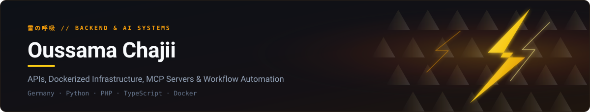

  

### About

Backend and AI engineer focused on reliable APIs, Dockerized infrastructure, MCP server integrations, and automated worker pipelines. I build end-to-end systems designed for clarity, automated testing, and predictable deployment.

---

### Selected Work

#### [etsy-automation](https://github.com/oussamac10/etsy-automation)
End-to-end AI and workflow automation pipeline for print-on-demand: market scoring, AI asset generation, print-ready image processing, and listing preparation.
- FastAPI backend paired with asynchronous background workers and PostgreSQL persistence
- Docker Compose orchestration, Nuxt 3 frontend, and an automated Playwright + backend test suite (98 test files)

`Python` · `FastAPI` · `PostgreSQL` · `Nuxt 3` · `Docker`

 

#### [docker-mastery](https://github.com/oussamac10/docker-mastery) — [Live Demo](https://docker-mastery-frontend.vercel.app)
AI-assisted DevOps environment generator featuring stack analysis, multi-service orchestration templates, and security-first container defaults.
- TypeScript stack analyzer and Dockerfile / Compose generator API with Nginx reverse-proxy setup
- Automated Docker Build & Push CI pipeline and live Next.js frontend deployed on Vercel

`TypeScript` · `Next.js` · `Docker` · `Nginx` · `CI/CD`

 

#### [Ai-application-assistant](https://github.com/oussamac10/Ai-application-assistant)
Multilingual AI form assistant bridging language barriers by separating `sourceLanguage`, `userLanguage`, and `outputLanguage` for guided form completion.
- FastAPI, Next.js, PostgreSQL, and Docker Compose foundation with automated CI checks
- Guided field-by-field normalization, validation, and confirmation workflow

`TypeScript` · `Python` · `FastAPI` · `Next.js` · `Docker` · `LLM`

---

### Tech Stack

| Area | Technologies |
| :--- | :--- |
| **Backend & Data** |       |
| **AI & Automation** |     |
| **DevOps & Frontend** |         |

  

